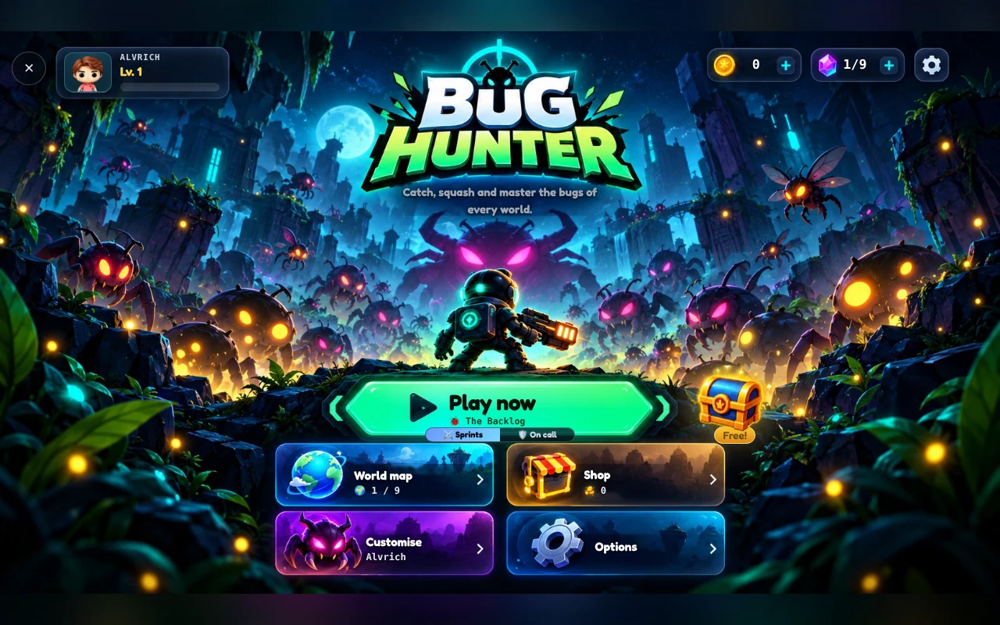
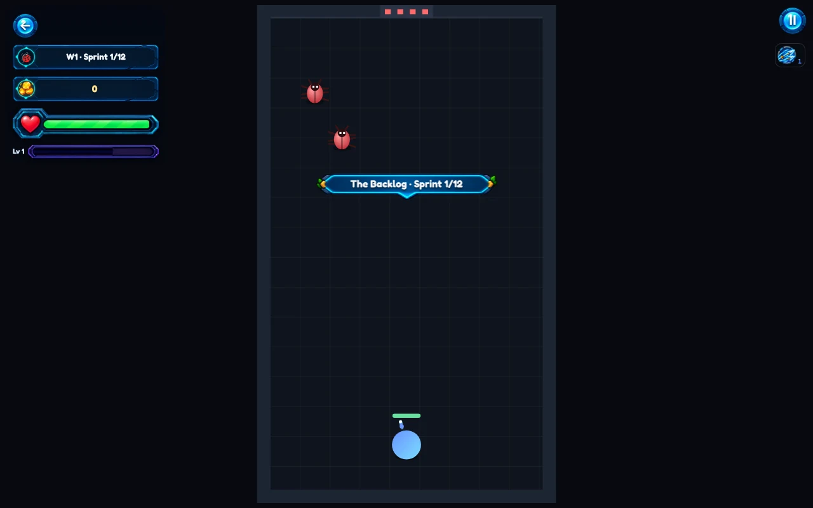

<p align="center">
  
</p>

# BUG HUNTER

An action roguelite and tactical auto-battler by **Álvaro Rodríguez Molina**, playable in the browser on mobile and desktop.

**[Play](https://alvrich.vercel.app/game.html) · [Changelog](./CHANGELOG.md) · [Code](./src/) · [Assets](./assets/) · [Migration guide](./docs/structure.md)**

This folder is the game's home inside MyPersonalWeb. Code, art, HTML, documentation and game-specific checks live here. The portfolio remains outside this folder; both use the shared root package and Vite build.

<p align="center">
  
</p>

## Modes

| Mode | How it plays |
|---|---|
| **Sprints** | Room-by-room action: clear enemies, choose upgrades and fight bosses. |
| **On Call** | Survive waves on a scrolling field, with bosses during the run. |
| **Battle — Tactics** | Buy units, arrange your army and reserves, and upgrade matching units' stars before automatic combat. |
| **Battle — Fusion** | Summon and combine matching units into the next character tier before automatic combat. |

Boss Rush, Nightmare and the boss showcase are additional options as they become available. Game text is maintained in English and Spanish in `src/strings.ts`.

## Controls

In action modes, drag on a touch screen or use WASD / the arrow keys. In Sprints, stand still to fire ranged weapons; melee and magic keep working while moving. On Call also permits ranged attacks while moving at a reduced rate. Collect experience and choose upgrades during the run.

In Battle, use the preparation phase to buy, deploy, reposition and combine units, then start the fight. Combat is automatic; the game provides its own battle controls.

## Nine worlds

| # | World |
|---|---|
| 1 | The Backlog |
| 2 | Hotfix Inferno |
| 3 | Code Freeze |
| 4 | Big Ball of Mud |
| 5 | Legacy Jungle |
| 6 | The Arena |
| 7 | The Forge |
| 8 | Haunted Servers |
| 9 | The Core |

## Project layout

```text
bug-hunter/
  README.md                 Start here
  CHANGELOG.md              Game releases
  AGENTS.md                 Development guardrails
  game.html                 Canonical page template
  src/
    main.ts                 Page, input, menus and frame loop
    world.ts                Action-mode rules
    board.ts                Battle rules
    boardBoss.ts            Tactical boss attack planning
    draw.ts                 Canvas rendering
    boardView*.ts           Board rendering and stable viewport
    game.css                Game styles
    audio.ts                Procedural music and sound
    save.ts                 Saved progress
    strings.ts              English and Spanish game text
    version.ts              Game version
  assets/                   Sprites, effects, UI, floors and world art
  lib/storage.ts            Adapter to shared portfolio storage
  build/                    Shared-build integration
  scripts/                  Gameplay and published-asset checks
  tests/                    Layout/integration tests
  docs/                     Structure and retained design history
```

## Run and build

Use the repository's **Node 24.x** requirement and run these from the repository root:

```bash
npm ci
npm run dev:game             # Open the existing /game.html route
npm run test:game:layout     # Dependency-free preparation/integration tests
npm run typecheck           # Includes bug-hunter/src and the integration types
npm run test:game            # Existing gameplay regression checks, relocated
npm run build               # Site + game, then verify published game assets
npm run preview
```

There is no second package installation inside this folder. Vercel continues using the repository root and `npm run build`; no new deployment project is required.

## Asset paths: source versus browser

| Edit this repository path | Existing public URL |
|---|---|
| `bug-hunter/assets/bosses/overlord-0.webp` | `/images/game/bosses/overlord-0.webp` |
| `bug-hunter/assets/ui/logo.webp` | `/images/game/ui/logo.webp` |
| `bug-hunter/game.html` | `/game.html` |

The build integration mirrors public files into an ignored `.cache/` directory and generates the root HTML entry. Vite then emits the existing site layout into `dist/`; the shared build copies it to `public/` for deployment. Do not edit those generated locations, recreate the old source folders, or rename browser URLs merely because repository folders moved.

See [asset conventions](./assets/README.md) and [the structure/migration notes](./docs/structure.md). No sprite resizing, gameplay changes, save-key changes or combat-layout changes are part of this reorganization.

<p align="center">
  
</p>
