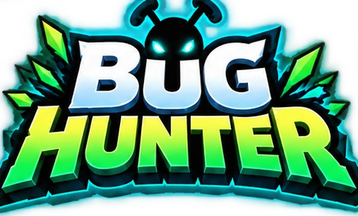
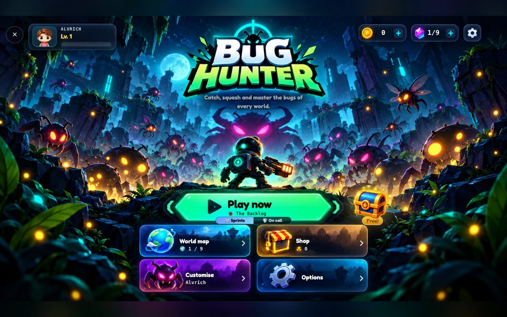
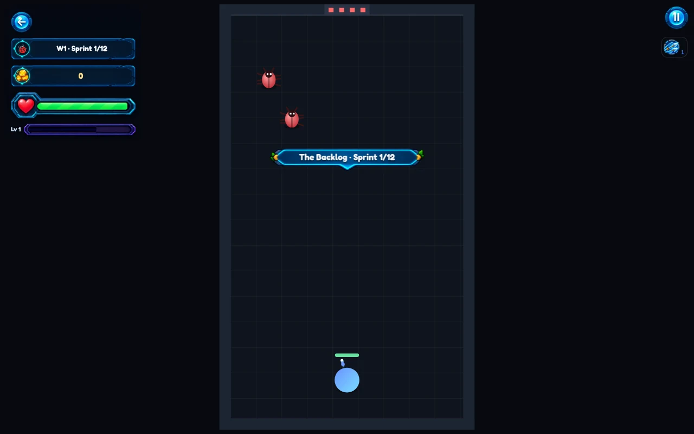
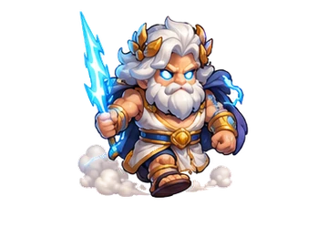

  

  <b>Ten sprints of bugs between you and the release. Clear every room to ship.</b> 
  A small Archero-style room shooter with Survivor.io-style weapons.  
  <a href="https://alvrich.vercel.app/game.html">Play it in the browser</a> · by <a href="https://alvrich.vercel.app">Álvaro Rodríguez Molina</a>

  

## How to play

- **Move:** drag anywhere on touch screens, or use WASD / the arrow keys.
- **Shoot:** stand still. Ranged weapons (the bow, knives, a boomerang) fire at the nearest bug.
- **Melee and magic** work all the time, whether you move or not.
- Bugs drop XP gems. Every level-up offers three picks: one melee, one magic, and one ranged weapon or upgrade.
- Clear a room and its door opens to the next sprint. Shrine rooms have no bugs: a statue heals you or grants a random skill.

### Modes

- **Sprints:** the room-by-room run. Twelve sprints per run, with bosses along the way.
- **On call:** an open field that scrolls with you. Bugs pour in from every side for ten minutes, with a boss at minute five and the final one at minute ten.

## Worlds

The game has nine worlds, each with its own element, colours and hazard:

| # | World | Hazard |
|---|-------|--------|
| 1 | The Backlog | none (the plain backlog) |
| 2 | Hotfix Inferno | lava |
| 3 | Code Freeze | ice |
| 4 | Big Ball of Mud | puddles that slow you down |
| 5 | Legacy Jungle | thorns |
| 6 | The Arena | lightning strikes |
| 7 | The Forge | bouncy walls |
| 8 | Haunted Servers | none (ghosts) |
| 9 | The Core | mixed |

  

## Assets

The art lives in this folder. Most sprites are WebP, and each animated sprite has one file per frame.

| Folder | Contents | Files |
|--------|----------|------:|
| `hero/` | The player in several outfits and poses (idle, walk, shoot, hurt, cheer) | 184 |
| `enemies/` | Bugs, legacy enemies and bosses, one set per world | 170 |
| `bosses/` | The boss sprites | 135 |
| `skills/` | Skill icons and their evolutions | 74 |
| `fx/` | Hit, explosion and spell effects | 133 |
| `ui/` | Buttons, panels, HUD, the wheel of fate and the logo | 107 |
| `arrows/`, `blades/`, `spirits/` | Bow arrows, saw blades and the spirit companions | 76 |
| `map/`, `floors/`, `jungle/`, `viking/`, `greek/`, `robot/`, `demon/`, `nightmare/`, `original/`, `core/`, `forge/` | Backgrounds, floors and the cast of each world | 136 |
| `items/`, `store/`, `slots/` | Items, shop art and equipment slots | 30 |
| root | Covers, landing backgrounds and favicons / app icons | 9 |

A few highlights:

  
  &nbsp;
  
  &nbsp;
  
  &nbsp;
  
  &nbsp;
  
  &nbsp;
  
  &nbsp;
  

## Code

The game is in [`src/game/`](../../../src/game) and its page is [`game.html`](../../../game.html):

- `world.ts`: the rules, with no drawing and no DOM.
- `draw.ts`: the canvas renderer.
- `scene.ts`: the title-screen show.
- `audio.ts`, `save.ts`, `shop.ts`, `strings.ts`: sound, saved progress, the shop and the game's own text (English and Spanish).
